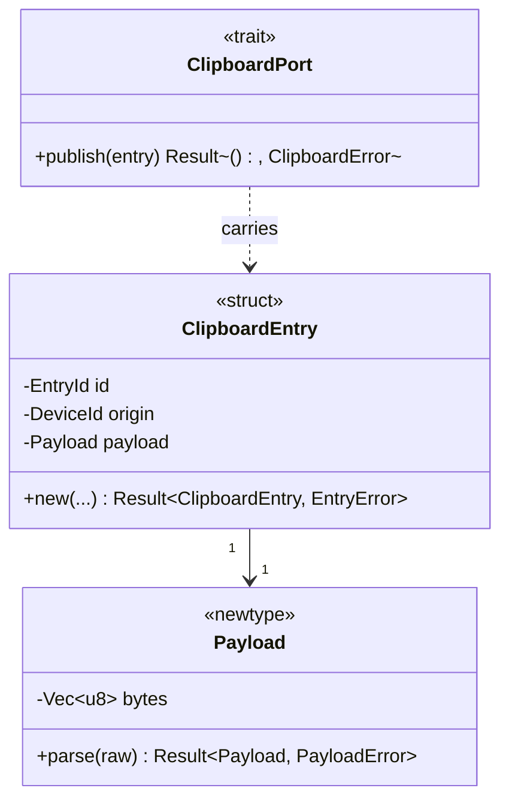

# SPDD REASONS Canvas

Generate an implementation-ready structured prompt using the REASONS Canvas,
specialised for **Bifrost**: a Rust Cargo workspace for peer-to-peer clipboard,
notification and file sync over Tailscale, with a platform-independent core,
strict clippy, arch-lint crate boundaries and behaviour-named tests.

**Input**: a GitHub issue whose body holds the analysis from `/spdd-analysis`
under `## Analysis`, plus optional `@` reading material.

```text
/spdd-reasons-canvas #12
/spdd-reasons-canvas #12 @docs/notes.md
```

## Steps

1. **Resolve the work item (REQUIRED)**

   a. Extract the issue number from the input: `#12`, `GH-12`, an issue URL, or
   the `GH-<n>-` prefix of a referenced `spdd/prompt/` file. If there is none,
   ask the user. Never invent a number.

   b. Verify it with `gh issue view <n> --json number,title,state,body`. Not
   found → stop. Closed → warn and ask. The title and body, with `## Analysis`,
   are the business context.

   c. **Taxonomy.** `AGENTS.md` section 7 requires exactly one `type:` label, at
   least one `area:` label and one milestone (and a parent, epics excepted).
   Check them with `gh issue view <n> --json labels,milestone`. Warn, naming the
   missing field, and ask whether to continue.

   d. **Exemption.** `AGENTS.md` section 5: spikes (the `type:spike` label) are
   exempt from SPDD. Say so and ask whether to continue anyway; never refuse.

   **Size gate.** `AGENTS.md` section 5: an issue with Effort 5 or more follows
   SPDD, and its analysis is the gate (no code before the analysis exists). An
   issue below Effort 5 has no SPDD artifacts. Effort is read at triage, and the
   analysis may raise it. Read the size: find the Project titled "Bifrost" with
   `gh project list --owner jaoppb --format json`, then
   `gh project item-list <number> --owner jaoppb --limit 1000 --format json`,
   and take the Effort of the item for `<n>`; a missing `project` scope is fixed
   with `gh auth refresh -s project`. Below the threshold, not set, or
   unreadable → stop with one short message and ask "Continue anyway?". Never
   refuse; on no, change nothing.

   **Analysis check.** If the requirement has no `## Analysis` heading, stop and
   tell the user to run `/spdd-analysis #<n>` first. A canvas written from a
   bare requirement has no mapping onto the code, no decisions and no risks.

2. **Consolidate the context**

   - The requirement, including `## Analysis`, is the context. If the input adds
     requirement text the requirement lacks, ask the user to add it there first.
   - Read ALL `@` references completely (every relevant file in a folder).
     Report any that fail.
   - Do NOT summarise or truncate.

3. **Read the ground rules and the relevant code**

   Always read:
   - `AGENTS.md`: the canonical rules
   - Read the root `Cargo.toml` (workspace members, `[workspace.dependencies]`,
     `[workspace.lints]`)
   - Read `arch-lint.toml` (scopes and the `core-stays-platform-independent`
     deny list) and `clippy.toml` (thresholds)
   - Read `justfile` (the recipes) and `tools.toml` (the issue workflow)

   Then, scoped to the requirement:
   - The affected modules and their layers
   - The existing shared types to reuse before inventing new ones
   - The existing interfaces and implementations in the affected modules, and
     the tests and test doubles

4. **Apply the REASONS Canvas.** Generate fully populated content for all seven
   sections.

### R: Requirements

```text
## Requirements
- Issue: #<n> — <issue title>
[Concise verb phrases describing the essence of the requirement]

### Definition of Done
- [Observable, verifiable outcomes]

### Out of scope
- [Explicit exclusions]
```

- What problem, for whom, and what value; the scope and what is explicitly not
  done
- Verb phrases ("Record…", "Derive…"); abstract the essential problem instead of
  listing features
- The core requirement fits in one sentence, and the Definition of Done is
  testable

### E: Entities

````text
## Entities

````

- Mark every type with a stereotype: `<<struct>>`, `<<newtype>>`, `<<enum>>`,
  `<<trait>>`, `<<error>>`
- Under the diagram, note the owning crate and layer of each type
- **Primitives are wrapped**: domain fields are newtypes, never bare `String`,
  integers or `bool` (`AGENTS.md` section 3 forbids boolean flags in signatures
  and structs).
- **Fields are private** (`-`), behaviour is public (`+`); no needless `pub`
  (`unreachable_pub` is forbidden).
- **Errors are types**: one `<<error>>` enum per module boundary, never a leaked
  foreign error.
- **Platform concepts stay out of `bifrost-core`**: a need of the core that only
  a platform can meet is a `<<trait>>` owned by the core and implemented by an
  adapter.
- **No floating point or unchecked integer arithmetic** in modelled fields.

**Conservative constraints (CRITICAL)**: reuse existing types first; leave
current types unchanged when they already meet the requirement; restructure only
when the requirement cannot be met otherwise; extend rather than rebuild. No
speculative abstractions.

### A: Approach

```text
## Approach
1. Domain design:
   - [Value objects, invariants, state; key decisions and rationale]
2. Crate boundaries and flow:
   - [Which crate owns what; traits declared in the core; how the daemon wires adapters]
3. Error strategy:
   - [Error enums per boundary; adapter to core mapping; what the user sees]
4. Platform and transport integration:
   - [Adapters per OS, Tailscale, wire protocol; or "None"]
5. Test strategy:
   - [Behaviour-named tests per use case with fakes; a check's test pair]
6. Rule and boundary changes:
   - [New `AGENTS.md` rules, `arch-lint.toml` deny-list lines, or "None"]
```

- Follow `AGENTS.md`
- Give the rationale for each decision and name the rejected alternatives
- Name the risks and how the design contains them

### S: Structure

```text
## Structure

### Crates and modules
1. `bifrost-core` — [new or changed value objects, traits, errors]
2. `bifrostd` — [wiring, adapters it provides]
3. `tools/<name>` — [new or changed check, or "None"]

### Trait implementations
1. `LinuxClipboard` implements `ClipboardPort`
2. `InMemoryClipboard` implements `ClipboardPort` (test fake)

### Dependencies
1. [Use case] depends on [traits]
2. [Daemon wiring] provides [adapter] for [trait]
3. New crate dependencies: [crate, version, which crate uses it] or "None"

### Boundary rules
1. [`arch-lint.toml` scopes or deny-list lines to add or confirm]
```

- `bifrost-core` uses no platform crate (Windows, macOS, Android, Wayland, D-Bus
  bindings) and neither the daemon nor the tools
- `bifrostd` is built on `bifrost-core`; the tools under `tools/` check the
  workspace and never use the product crates
- A new platform crate is added to the deny list in `arch-lint.toml` in the pull
  request that introduces it
- The final crate layout and the per-OS adapter template are decided by
  spike #23 and written into `AGENTS.md` section 2 by #50; until then those are
  the only rules
- Shared dependency versions live in `[workspace.dependencies]`, a 0.x
  dependency that breaks between releases is pinned exactly, and `just deny`
  (licenses, advisories, bans, sources) must pass (`AGENTS.md` section 3).;
  justify each new dependency in the Approach
- Every component has exactly one home, and the dependency graph stays acyclic
  and within the boundary rules

### O: Operations

```text
## Operations

### 1. Create value object - `Payload` (`bifrost-core`)
1. Responsibility: [what it guarantees]
2. Representation: [private inner type and invariants]
3. Constructors: `parse(raw: &[u8]) -> Result<Payload, PayloadError>` — [rules]
4. Behaviour: [methods, each with purpose and signature in prose]
5. Tests: [behaviour cases, named as behaviour]

### 2. Define trait - `ClipboardPort` (`bifrost-core`)
1. Contract: [methods, errors, guarantees]
2. Contract tests: [cases every adapter must pass]

### 3. Implement use case - `PublishEntry` (`bifrost-core`)
1. Input: [command type]
2. Steps: [ordered logic, early returns, invariants]
3. Errors: [error enum variants and when]
4. Tests: [behaviour tests with an in-memory fake]

### 4. Implement adapter - `LinuxClipboard` (`bifrostd`)
1. Implements: [trait]
2. Error mapping: [platform error to core error]
3. Tests: [runs the trait contract tests]

### 5. Update boundaries - `arch-lint.toml`
### 6. Docs - `AGENTS.md` section(s) and, for a user-facing change, `README.md`
### 7. Verify - `just check`
```

- **Order by dependency**: value objects and errors in `bifrost-core` → traits →
  use cases → adapters → daemon wiring → boundaries (`arch-lint.toml`) → docs →
  verify
- Every operation names its crate and module, has one responsibility, and lists
  its tests (behaviour, not implementation)
- Write signatures in prose with inline code, never in code blocks (e.g.
  `publish(&self, entry: ClipboardEntry) -> Result<(), ClipboardError>`)
- The operations cover everything in Structure, with no logical gaps, and
  `/spdd-generate` can execute them directly
- **The last operation is always** `just check` passing with zero lint
  exceptions

### N: Norms

```text
## Norms
1. Baseline: `AGENTS.md` sections 2–5 apply in full
Error handling / Naming / Logging / Documentation / Tests
```

- Do not restate `AGENTS.md`; reference it and add only what is specific to this
  change
- Zero lint exceptions: no `#[allow(...)]`, `#[expect(...)]` and arch-lint
  suppressions (`AGENTS.md` section 1). Design the code to fit the rule.
- Use the same patterns as the existing modules

### S: Safeguards

```text
## Safeguards
1. Functional: [invariants with exact conditions]
2. Architecture: [crate boundaries; `arch-lint.toml`; no platform crate in the core]
3. Lints: [clippy and arch-lint pass with zero exceptions; `clippy.toml` thresholds]
4. Errors: [exact error enum variants and Display messages]
5. Performance: [measurable limits]
6. Security & privacy: [no secrets, tokens or synced content in logs]
7. Tests: [required behaviour tests; a new check has a failing and a passing test]
```

- Each safeguard can be checked by a test, by `just check`, or by review;
  quantify where possible
- Error messages written here are copied verbatim by `/spdd-generate`

5. **Construct the structured prompt**

   ```text
   # [Derived Requirement Title]

   - Issue: #<n>
   - Analysis: the `## Analysis` section of issue #<n>
   ```

   Then all seven sections, fully populated and in order. **Do NOT include** the
   raw business context, framework metadata (objective, guidance, quality
   standards), a timestamp or the framework name. No placeholders or TODOs.

   **No code blocks (CRITICAL)**: no source-language blocks, type or function
   bodies, query statements or config snippets. Describe signatures in prose
   with inline code. Mermaid diagrams are allowed.

6. **Save the canvas**

   a. File name: `GH-<n>-{TIMESTAMP}-[{ACTION}]-{scope}-{description}.md`.
   `TIMESTAMP` is `YYYYMMDDHHmm`. `ACTION` is one of `[Feat]`, `[Fix]`,
   `[Refactor]`, `[Test]`, `[Docs]`, `[Chore]`. `scope` is the most affected of
   `core`, `daemon`, `tools`, `workspace` / `docs`. `description` is kebab-case,
   < 10 words.

   b. Create `spdd/prompt/` if it is missing, and write the file there. The
   canvas is an ephemeral working file for the current branch. `spdd/prompt` is
   gitignored: never stage it, never commit it, and never name it by path in a
   commit message, an issue or a pull request (write `#<n>` in prose).

   c. **Existing or lost canvas.** If a canvas for this work item already
   exists, ask whether to update it with `/spdd-prompt-update` instead of
   writing a second one. If it is missing partway through a branch (recreated
   worktree, new checkout, a switch of agent), regenerate it from `## Analysis`
   and the code already written (`git diff main...HEAD`), and say that it was
   regenerated, since it may differ from the first. Anything only the lost
   canvas knew belongs in the code, the tests or the design docs.

   **Stale canvas.** If the branch code changed outside the canvas (review
   fixes, a hand refactor) and more code will be generated from it, rebuild it
   the same way, with the canvas as a third input. Code wins over the old
   canvas, and every difference is listed for the user. There is no separate
   sync step: the canvas only has to be right for the rest of this branch.

   d. Show a summary: the path, a one-line summary of each section, the counts
   of types, operations and safeguards.

7. **Ask before implementing**: "The REASONS Canvas is ready. Proceed with
   `/spdd-generate`?"

## Markdown output

Everything this skill writes must pass `just fmt-check`. Every fenced block has
a language (`text`, `mermaid`). Use real headings, never bold lines. Put blank
lines around headings, lists and fences.

## Guardrails

- **CRITICAL**: generate fully populated content for all seven sections, never
  just headers
- Do NOT proceed without a resolved work item, or when the size gate or the
  analysis check stopped and the user did not confirm
- Do NOT include framework metadata, code blocks, placeholders or TODOs
- Do NOT implement code before the user confirms the canvas
- The file name MUST follow the convention above
- Never stage or commit a file under `spdd/prompt`, and never name a canvas by
  path outside the working tree
- Every operation MUST name its crate and module and list its tests
- Conservative entity design: reuse existing types and avoid unnecessary
  refactoring
- Read ALL `@` references completely and merge them with the requirement into
  one context, preserving its intent
